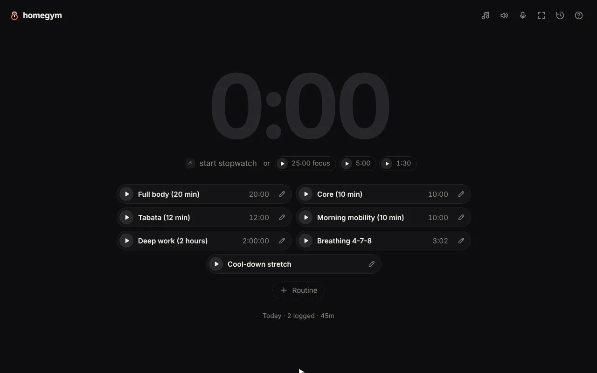

<p align="center">
  
</p>

<h1 align="center">homegym</h1>

<p align="center">
  A minimalist workout and focus timer you can run without thinking about it.<br>
  Type <code>25m</code>, press Enter, and go.
</p>

<p align="center">
  <b>DEMO:</b> <a href="https://mr-grj.github.io/homegym/">mr-grj.github.io/homegym</a><br>
  <sub>Runs entirely in your browser. Nothing you add leaves your device.</sub>
</p>

<p align="center">
  <a href="https://mr-grj.github.io/homegym/"></a>
</p>

## Features

- **Instant timers.** Type `25m`, `1:30` or `5m plank` into the big clock and press Enter. An empty Enter starts a stopwatch.
- **Routines your way.** Build them with fields (pick an exercise you used before, tap a duration, drag to reorder) or write them as plain text. Both show a live preview as you go.
- **Readable from across the room.** Huge digits, colour-coded work and rest phases, a progress fill and a timeline of the whole routine.
- **Hands-free cues.** Countdown beeps for the last three seconds, a chime between steps, and a voice that reads out the next exercise, using the most natural voice your device has or one you pick. The screen stays awake.
- **Music that follows the timer.** Paste a YouTube Music or SoundCloud link: it plays when you start, pauses when you pause, gets quieter for the countdown and fades out at the end. Each playlist resumes where you left off.
- **A log you'll actually keep.** At the end of a workout, tick the blocks you finished, rate the effort and add a note. History shows daily totals.
- **Keyboard first, phone friendly.** Every action has a shortcut and a tooltip, and the layout adapts to small screens.
- **Self-hosted.** One `docker compose up`. Routines, history and settings live in SQLite and sync across your devices.

## Quick start

Requires Docker.

```sh
git clone https://github.com/mr-grj/homegym.git
cd homegym
docker compose up -d --build
```

Open [http://localhost:4321](http://localhost:4321). Set `HOMEGYM_PORT` to use another port.

## Using it


| Type into the clock | Result |
| --- | --- |
| `25m` · `25` · `1:30` · `90s` · `1h 15m` | Countdown |
| `5m plank` | Countdown with a label |
| Nothing | Stopwatch |
| Part of a routine name | Opens that routine |
| A YouTube Music or SoundCloud link | Loads the music |

| Key | Action |
| --- | --- |
| `Space` · `Enter` | Start, pause, resume |
| `→` · `←` | Next step · restart or previous step |
| `↑` · `↓` | Add or remove a minute |
| `Esc` | Stop and log |
| `T` | Remaining or elapsed time |
| `S` · `V` | Sound · voice |
| `M` · `[` · `]` | Music: play/pause, previous, next |
| `H` · `?` | History · all shortcuts |
| `⌘Z` | Undo what the last message offers to undo |
| `⌘⏎` · `⌘⇧⏎` | In the editor: save · save as a new routine |
| `⌘E` | In the editor: switch between builder and text |
| `⏎` · `⌥↑` `⌥↓` | In the builder: add the next step · move a step or block |

On Windows and Linux, `⌘` is `Ctrl` and `⌥` is `Alt` (the app shows them that way). On the start screen letters type into the clock, so press `Esc` first to use them as shortcuts.

Quick timers are logged automatically. Routines end with a short finish sheet. Anything you delete can be undone for a few seconds.

## Routines

Press **+ Routine** and build it in the **Builder**:

- Type an exercise name and pick a duration. Names you've used in other routines are suggested, and picking one fills in its usual duration and note.
- `⏎` adds the next step, the dot switches between exercise and rest, and `−` `+` set how many times a block repeats.
- Drag the handle (or press `⌥↑` `⌥↓`) to move steps and blocks. Removing something shows an undo, and `⌘Z` works too.
- Click any step in the preview to jump to it.

Prefer typing? Switch to **Text** (`⌘E`). Both edit the same routine, and the editor remembers your choice on each device. A routine is plain text:

```text
# Core (10 min)

## Activation
Dead bug 30s
Glute bridge 30s

## Circuit ×3
Plank 45s
> shoulders over wrists · squeeze glutes
~ Rest 15s
Hollow hold 30s
~ Rest 15s
```

| Line | Meaning |
| --- | --- |
| `# Title` | Routine name |
| `## Block ×3` | A block, repeated 3 times (`x3` works too) |
| `Exercise 45s` | A step. Durations: `45s`, `2m`, `1:30`, `1m30s` |
| `~ Rest 15s` | A rest step, shown in the rest colour |
| `> text` | A note shown under the current step |
| `Exercise` | No duration: runs until you press `→` |

The [`examples/`](examples) folder has ready-made routines for strength, HIIT, mobility, breathing and focused work. Paste one into **+ Routine** in the Text view and adjust it in either view.

To make a variation of a routine, open it, change what you need and press **Save as new** (`⌘⇧⏎`). The original stays as it was, and the copy is named for you ("Full body (20 min) copy") unless you give it a new title.

## Music

Copy a share link from YouTube Music or SoundCloud (a playlist, album, artist or song) and press `⌘V` anywhere in homegym. If you're signed in to YouTube in the same browser, the player uses your account, so Premium means no ads.

Private YouTube playlists, including Liked Music, can't be embedded. Use a public or unlisted playlist instead. SoundCloud plays only a 30 second preview of Go+ tracks, and its short `on.soundcloud.com` links work in the self-hosted app but not in the demo.

## Data and backups

Routines, history and settings are stored in SQLite in the `homegym-data` Docker volume. Only the timer currently on screen stays in the browser.

```sh
docker compose cp api:/data/homegym.db ./homegym-backup-$(date +%F).db
```

`docker compose down -v` deletes the volume and everything in it.

## Development

```text
api/        FastAPI + SQLite (routines, sessions, settings)
web/        React + TypeScript + Vite, served by nginx
e2e/        Playwright tests, run against the browser-only demo build
examples/   Example routines
```

Run each side locally with hot reload. You need [uv](https://docs.astral.sh/uv/) and Node 22.12+.

```sh
cd api && uv run uvicorn app.main:app --reload
cd web && npm install && npm run dev
```

The dev server proxies `/api` to `localhost:8000`.

Tests, the same ones CI runs:

```sh
cd api && uv run pytest && uv run ruff check . && uv run mypy app tests
cd web && npm install && npm test && npm run build
cd e2e && npm install && npx playwright install chromium && npm test
```

The end-to-end tests build the demo and drive it with a fake clock, so no server is needed. Set `SELF_HOSTED_URL` to also run one test against a running stack. It writes to that stack, so point it at a throwaway one.

**Stack:** React 19, TypeScript 7, Vite 8, FastAPI, Python 3.14, SQLite, nginx, Docker Compose.

## License

[MIT](LICENSE) © mr-grj
