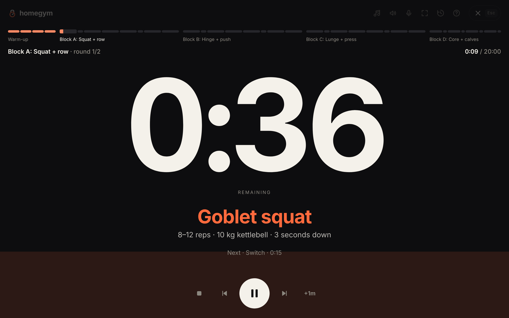
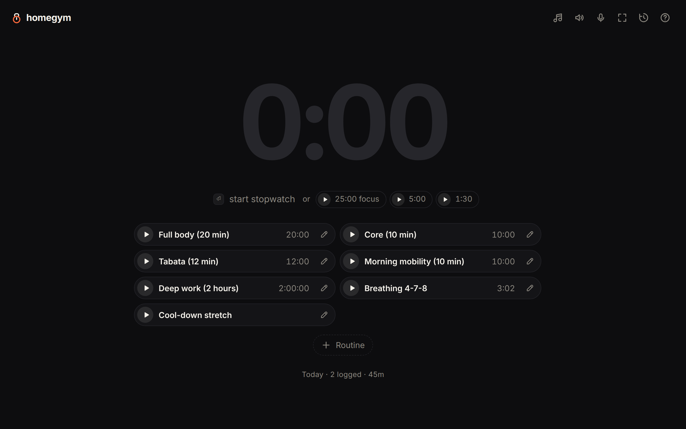
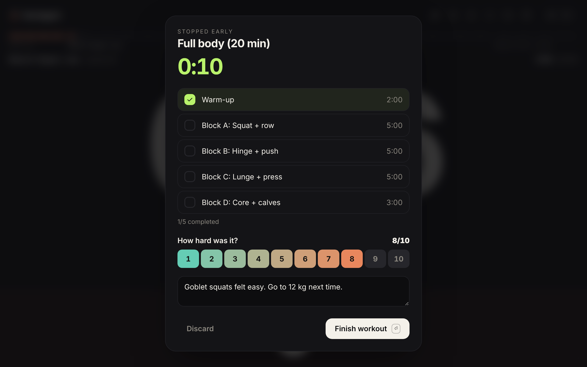
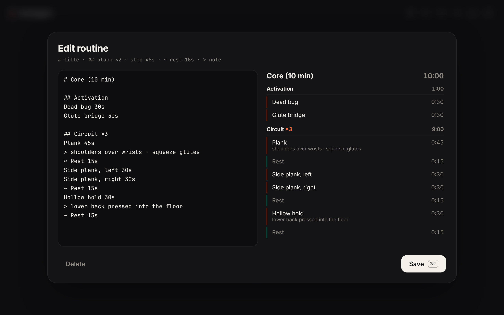
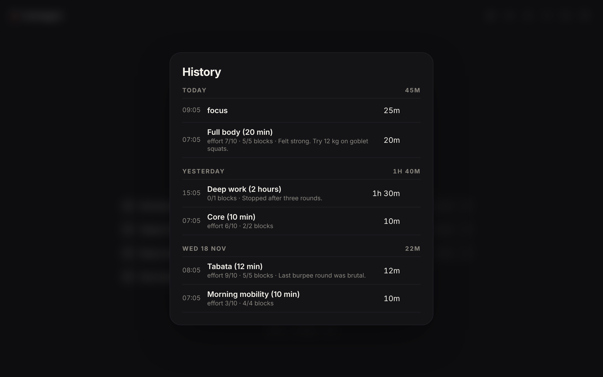
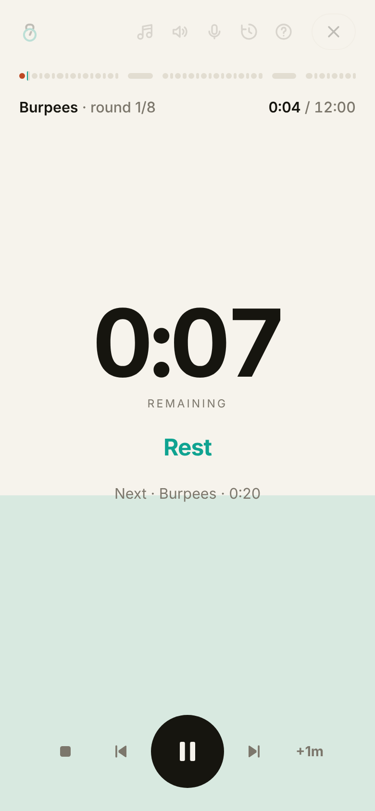

<p align="center">
  
</p>

<h1 align="center">homegym</h1>

<p align="center">
  A minimalist workout and focus timer you can run without thinking about it.<br>
  Type <code>25m</code>, press Enter, and go.
</p>

<p align="center">
  
</p>

## Features

- **Instant timers.** Type `25m`, `1:30` or `5m plank` into the big clock and press Enter. An empty Enter starts a stopwatch.
- **Plain-text routines.** Blocks, rounds, rests and notes in a format you can write in a minute. The editor shows a live preview as you type.
- **Readable from across the room.** Huge digits, colour-coded work and rest phases, a progress fill and a timeline of the whole routine.
- **Hands-free cues.** Countdown beeps for the last three seconds, a chime between steps, and a voice that reads out the next exercise. The screen stays awake.
- **Music that follows the timer.** Paste a YouTube Music link: it plays when you start, pauses when you pause, gets quieter for the countdown and fades out at the end. Each playlist resumes where you left off.
- **A log you'll actually keep.** At the end of a workout, tick the blocks you finished, rate the effort and add a note. History shows daily totals.
- **Keyboard first, phone friendly.** Every action has a shortcut and a tooltip, and the layout adapts to small screens.
- **Self-hosted.** One `docker compose up`. Routines, history and settings live in SQLite and sync across your devices.

<table>
  <tr>
    <td></td>
    <td></td>
  </tr>
  <tr>
    <td></td>
    <td></td>
  </tr>
</table>

## Quick start

Requires Docker.

```sh
git clone https://github.com/mr-grj/homegym.git
cd homegym
docker compose up -d --build
```

Open [http://localhost:4321](http://localhost:4321). Set `HOMEGYM_PORT` to use another port.

## Using it



| Type into the clock | Result |
| --- | --- |
| `25m` · `25` · `1:30` · `90s` · `1h 15m` | Countdown |
| `5m plank` | Countdown with a label |
| Nothing | Stopwatch |
| Part of a routine name | Opens that routine |
| A YouTube Music link | Loads the music |

| Key | Action |
| --- | --- |
| `Space` · `Enter` | Start, pause, resume |
| `→` · `←` | Next step · restart or previous step |
| `↑` · `↓` | Add or remove a minute |
| `Esc` | Stop and log |
| `T` | Remaining or elapsed time |
| `S` · `V` | Sound · voice |
| `M` · `[` · `]` | Music: play/pause, previous, next |
| `H` · `?` | History · all shortcuts |

Quick timers are logged automatically. Routines end with a short finish sheet. Anything you delete can be undone for a few seconds.

## Routines

A routine is plain text:

```text
# Core (10 min)

## Activation
Dead bug 30s
Glute bridge 30s

## Circuit ×3
Plank 45s
> shoulders over wrists · squeeze glutes
~ Rest 15s
Hollow hold 30s
~ Rest 15s
```

| Line | Meaning |
| --- | --- |
| `# Title` | Routine name |
| `## Block ×3` | A block, repeated 3 times (`x3` works too) |
| `Exercise 45s` | A step. Durations: `45s`, `2m`, `1:30`, `1m30s` |
| `~ Rest 15s` | A rest step, shown in the rest colour |
| `> text` | A note shown under the current step |
| `Exercise` | No duration: runs until you press `→` |

The [`examples/`](examples) folder has ready-made routines for strength, HIIT, mobility, breathing and focused work. Copy one into **+ Routine** and adjust it.

## Music

Copy a share link from YouTube Music (a playlist, album or song) and press `⌘V` anywhere in homegym. If you're signed in to YouTube in the same browser, the player uses your account, so Premium means no ads.

Private playlists, including Liked Music, can't be embedded. Use a public or unlisted playlist instead.

## Data and backups

Routines, history and settings are stored in SQLite in the `homegym-data` Docker volume. Only the timer currently on screen stays in the browser.

```sh
docker compose cp api:/data/homegym.db ./homegym-backup-$(date +%F).db
```

`docker compose down -v` deletes the volume and everything in it.

## Development

```text
api/        FastAPI + SQLite (routines, sessions, settings)
web/        React + TypeScript + Vite, served by nginx
examples/   Example routines
```

Run each side locally with hot reload:

```sh
cd api && uv run uvicorn app.main:app --reload
cd web && npm install && npm run dev
```

The dev server proxies `/api` to `localhost:8000`.

**Stack:** React 19, TypeScript 7, Vite 8, FastAPI, Python 3.14, SQLite, nginx, Docker Compose.
