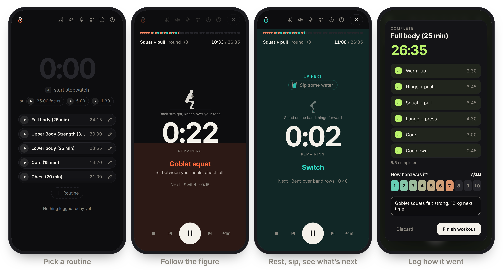

<p align="center">
  
</p>

<h1 align="center">homegym</h1>

<p align="center">
  A minimalist workout and focus timer you can run without thinking about it.<br>
  Type <code>25m</code>, press Enter, and go.
</p>

<p align="center">
  <b>DEMO:</b> <a href="https://mr-grj.github.io/homegym/">mr-grj.github.io/homegym</a><br>
  <sub>Runs entirely in your browser. Nothing you add leaves your device.</sub>
</p>

<p align="center">
  <a href="https://mr-grj.github.io/homegym/"></a>
</p>

## Features

- **Instant timers.** Type `25m`, `1:30` or `5m plank` into the big clock and press Enter. An empty Enter starts a stopwatch.
- **Routines your way.** Build them with fields (pick an exercise you used before, tap a duration, drag to reorder) or write them as plain text. Both show a live preview as you go.
- **Readable from across the room.** Huge digits, colour-coded work and rest phases, a progress fill and a timeline of the whole routine.
- **Hands-free cues.** Countdown beeps for the last three seconds, a chime between steps, and an English voice that reads out the next exercise, using the most natural voice your device has or one you pick. The screen stays awake.
- **Time to get into position.** Each timed exercise of 10 seconds or more opens with five seconds to set up, shown as a big countdown with the figure in its start pose, then the clock starts. Tap "Get into position" or press `G` to start early, or press `R` to turn it off.
- **A reminder to drink.** Every rest shows a small glass filling with water next to what comes up. Tap it, or press `W`, to add 15 seconds to the rest; it refills once you've used them. Both this and the time to get into position can be switched off in the workout options (`O`).
- **See how it's done.** When an exercise starts, a small figure shows it on a loop. During a rest it previews what comes next, marked "Up next", and it pauses with the timer. About 160 exercises are covered, in English and Romanian. Under the figure, one short line tells you how to set up while you wait and what to keep in mind once you start.
- **Music that follows the timer.** Paste a YouTube Music or SoundCloud link: it plays when you start, pauses when you pause, gets quieter for the countdown and fades out at the end. Each playlist resumes where you left off.
- **Time boxes, not rep counts.** Made for home workouts with whatever you have, like one kettlebell. Each exercise gets the time you choose and you fit in as many good reps as you can. To progress, lengthen the steps or add rounds.
- **A log you'll actually keep.** At the end of a workout, tick the blocks you finished, rate the effort and add a note. History shows the exercises you did and daily totals. Search it by exercise, note or date (`squat`, `nov 20`, `yesterday`), or pick a day on the calendar.
- **Keyboard first, phone friendly.** Every action has a shortcut and a tooltip, and the layout adapts to small screens.
- **Self-hosted.** One `docker compose up`. Routines, history and settings live in SQLite and sync across your devices.

## Quick start

Requires Docker.

```sh
git clone https://github.com/mr-grj/homegym.git
cd homegym
docker compose up -d --build
```

Open [http://localhost:4321](http://localhost:4321). Set `HOMEGYM_PORT` to use another port.

## Using it

<p align="center">
  
</p>

| Type into the clock | Result |
| --- | --- |
| `25m` · `25` · `1:30` · `90s` · `1h 15m` | Countdown |
| `5m plank` | Countdown with a label |
| Nothing | Stopwatch |
| Part of a routine name | Opens that routine |
| A YouTube Music or SoundCloud link | Loads the music |

| Key | Action |
| --- | --- |
| `Space` · `Enter` | Start, pause, resume |
| `→` · `←` | Next step · restart or previous step |
| `↑` · `↓` | Add or remove a minute |
| `Esc` | Stop and log |
| `T` | Remaining or elapsed time |
| `S` · `V` | Sound · voice |
| `D` | Exercise demos on or off |
| `R` · `G` | Get into position time (5 seconds before each exercise) on or off · start the exercise now |
| `W` | During a rest: take a sip, adds 15 seconds |
| `O` | Workout options: get into position time, water reminder, exercise demos |
| `M` · `[` · `]` | Music: play/pause, previous, next |
| `H` · `?` | History · all shortcuts |
| `⌘Z` | Undo what the last message offers to undo |
| `⌘⏎` · `⌘⇧⏎` | In the editor: save · save as a new routine |
| `⌘E` | In the editor: switch between builder and text |
| `⏎` · `⌥↑` `⌥↓` | In the builder: add the next step · move a step or block |

On Windows and Linux, `⌘` is `Ctrl` and `⌥` is `Alt` (the app shows them that way). On the start screen letters type into the clock, so press `Esc` first to use them as shortcuts.

Quick timers are logged automatically. Routines end with a short finish sheet. Anything you delete can be undone for a few seconds.

## Routines

Press **+ Routine** and build it in the **Builder**:

- Type an exercise name and pick a duration. Names you've used in other routines are suggested, and picking one fills in its usual duration and note.
- `⏎` adds the next step, the dot switches between exercise and rest, and `−` `+` set how many times a block repeats.
- Drag the handle (or press `⌥↑` `⌥↓`) to move steps and blocks. Removing something shows an undo, and `⌘Z` works too.
- Click any step in the preview to jump to it.

Prefer typing? Switch to **Text** (`⌘E`). Both edit the same routine, and the editor remembers your choice on each device. A routine is plain text:

```text
# Core (10 min)

## Activation
Dead bug 30s
Glute bridge 30s

## Circuit ×3
Plank 45s
> elbows under shoulders · squeeze glutes
~ Rest 15s
Hollow hold 30s
~ Rest 15s
```

| Line | Meaning |
| --- | --- |
| `# Title` | Routine name |
| `## Block ×3` | A block, repeated 3 times (`x3` works too) |
| `Exercise 45s` | A step. Durations: `45s`, `2m`, `1:30`, `1m30s` |
| `~ Rest 15s` | A rest step, shown in the rest colour |
| `> text` | A note shown under the current step |
| `Exercise` | No duration: runs until you press `→` |

The [`examples/`](examples) folder has ready-made routines for strength, HIIT, mobility, breathing and focused work. Paste one into **+ Routine** in the Text view and adjust it in either view.

To make a variation of a routine, open it, change what you need and press **Save as new** (`⌘⇧⏎`). The original stays as it was, and the copy is named for you ("Full body (20 min) copy") unless you give it a new title.

## Exercise demos

When a step's name matches a known exercise, the timer shows a looping figure of it: above the clock on a phone, beside it on a wide screen. During a rest it previews the next exercise under a small "Up next", it freezes while you're paused, and if your system asks for reduced motion it shows a still pose instead. A step whose name isn't known shows no figure, so a demo is never a guess. Variants that differ only in grip, such as a hammer curl or a chin-up, show their base exercise.

Names match whole, ignoring case, accents, plurals and punctuation: `Push-ups`, `push up` and `Flotări` all show the push-up. A `left` or `right` at the start or end picks the side (`Side plank, right`). In the builder, a small figure next to an exercise means it has a demo, and the suggestions include every exercise with a demo, a few at a time as you type. Press `D` to hide or show demos.

Under the figure sits one short technique hint. Before an exercise (during the rest that previews it, the get-into-position countdown, and before you press start) it says how to set up, such as "Elbows under shoulders, legs long". Once the exercise runs it switches to one thing to keep while moving, such as "Hips level, body in one straight line". It is a fixed line, never spoken, and its space is kept for the whole workout so nothing shifts. A note you wrote for a step stays under the exercise name, so you see both. Every exercise with a figure has a hint, each checked against ACE, ExRx, NASM, NHS, Harvard Health, Yoga Journal, StrongFirst and similar references, listed next to the hints in `web/src/hints.ts`.

<details>
<summary>Exercises with a demo</summary>

90/90 hip switch, Ab wheel rollout, Alternating lunge, Arm circles, Band biceps curl, Band chest press, Band face pull, Band lateral raise, Band lateral walk, Band overhead triceps extension, Band pull-apart, Band shoulder press, Bear crawl, Bench dip, Bent-over band row, Bent-over dumbbell row, Biceps curl, Bicycle crunch, Bird dog, Bodyweight squat, Box jump, Bulgarian split squat, Burpee, Butt kicks, Butterfly stretch, Calf raise, Calf stretch at the wall, Cat-cow, Chair pose, Chest opener, Child's pose, Child's pose lat stretch, Cobra, Concentration curl, Crab walk, Cross-body shoulder stretch, Crunch, Curtsy lunge, Dead bug, Decline push-up, Deep squat hold, Donkey kicks, Doorway chest stretch, Downward dog, Dumbbell bench press, Dumbbell calf raise, Dumbbell clean, Dumbbell deadlift, Dumbbell lunge, Dumbbell overhead press, Dumbbell pullover, Dumbbell reverse lunge, Dumbbell Romanian deadlift, Dumbbell shrug, Dumbbell side bend, Dumbbell squat, Dumbbell step-up, Dumbbell thruster, Floor press, Flutter kicks, Front raise, Glute bridge, Glute bridge march, Goblet squat, Half-kneeling hip flexor stretch, Hand-to-hand kettlebell curl, Handstand push-up, Hanging knee raise, Hanging leg raise, Happy baby, High knees, High plank, Hip circles, Hip hinge, Hip thrust, Hollow hold, Hollow rocks, Inchworm, Incline dumbbell press, Incline push-up, Inverted row, Jump squat, Jumping jack, Jumping lunge, Kettlebell clean, Kettlebell deadlift, Kettlebell floor pullover, Kettlebell halo, Kettlebell high pull, Kettlebell press, Kettlebell snatch, Kettlebell swing, Kettlebell windmill, Knee push-up, Knee to chest, Kneeling kettlebell biceps curl, Lateral lunge, Lateral raise, Leg raise, Leg swings, Lying hamstring stretch, Lying toe taps, Medicine ball slam, Mountain climber, Overhead triceps extension, Overhead triceps stretch, Pigeon pose, Pike push-up, Pistol squat, Plank, Plank shoulder taps, Plank to downward dog, Plank up-down, Pull-up, Push-up, Rear delt fly, Renegade row, Reverse crunch, Reverse lunge, Reverse plank, Romanian deadlift, Runner's lunge, Running in place, Scapular push-up, Seal jacks, Seated band row, Seated forward fold, Shadow boxing, Shoulder circles, Side plank, Single-arm dumbbell row, Single-arm kettlebell press, Single-arm kettlebell row, Single-leg deadlift, Single-leg glute bridge, Sit-up, Skater hops, Skull crusher, Sphinx pose, Spiderman push-up, Split squat, Stability ball back extension, Stability ball crunch, Standing band row, Standing hamstring stretch, Standing hip abduction, Standing quad stretch, Standing side stretch, Standing toe touch, Star jump, Step-up, Sumo squat, Superman, Thoracic rotation, Toe touch crunch, Tree pose, Triceps kickback, Tuck jump, Turkish get-up, Upright row, Upward dog, V-up, Wall ball, Wall push-up, Wall sit, Wall slide, Warrior II, World's greatest stretch.

</details>

The figures are drawn by homegym itself from a few key poses per exercise, with a bench, box, pull-up bar, ball, band or weights when the exercise needs one, so they load instantly, work offline and follow your theme. [Open Exercise Figures](https://github.com/AbanoubAmir/open-exercise-figures) (CC0) was the reference for some of the poses.

## Music

Copy a share link from YouTube Music or SoundCloud (a playlist, album, artist or song) and press `⌘V` anywhere in homegym. If you're signed in to YouTube in the same browser, the player uses your account, so Premium means no ads.

Private YouTube playlists, including Liked Music, can't be embedded. Use a public or unlisted playlist instead. SoundCloud plays only a 30 second preview of Go+ tracks, and its short `on.soundcloud.com` links work in the self-hosted app but not in the demo.

## Data and backups

Routines, history and settings are stored in SQLite in the `homegym-data` Docker volume. Only the timer currently on screen stays in the browser.

```sh
docker compose cp api:/data/homegym.db ./homegym-backup-$(date +%F).db
```

`docker compose down -v` deletes the volume and everything in it.

## Development

```text
api/        FastAPI + SQLite (routines, sessions, settings)
web/        React + TypeScript + Vite, served by nginx
e2e/        Playwright tests, run against the browser-only demo build
examples/   Example routines
```

Run each side locally with hot reload. You need [uv](https://docs.astral.sh/uv/) and Node 22.12+.

```sh
cd api && uv run uvicorn app.main:app --reload
cd web && npm install && npm run dev
```

The dev server proxies `/api` to `localhost:8000`.

Tests, the same ones CI runs:

```sh
cd api && uv run pytest && uv run ruff check . && uv run mypy app tests
cd web && npm install && npm test && npm run build
cd e2e && npm install && npx playwright install chromium && npm test
```

The end-to-end tests build the demo and drive it with a fake clock, so no server is needed. Set `SELF_HOSTED_URL` to also run one test against a running stack. It writes to that stack, so point it at a throwaway one.

**Stack:** React 19, TypeScript 7, Vite 8, FastAPI, Python 3.14, SQLite, nginx, Docker Compose.

## License

[MIT](LICENSE) © mr-grj
